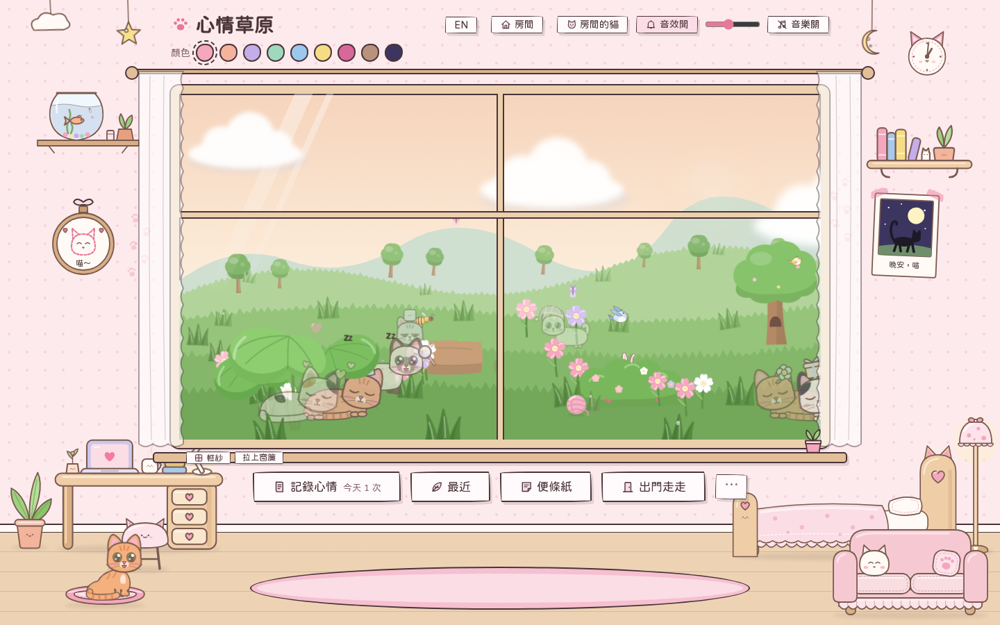
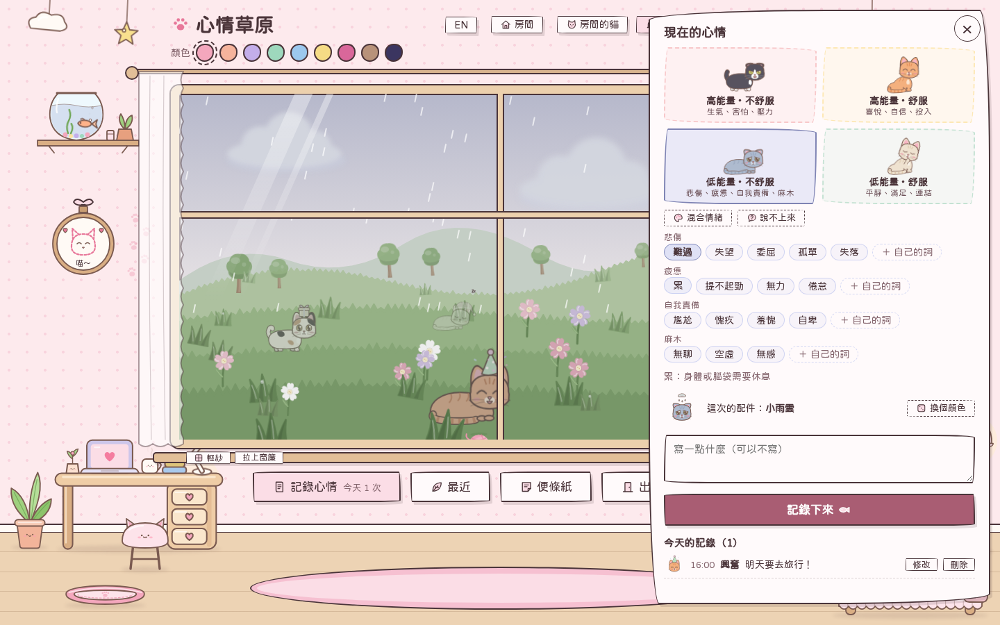
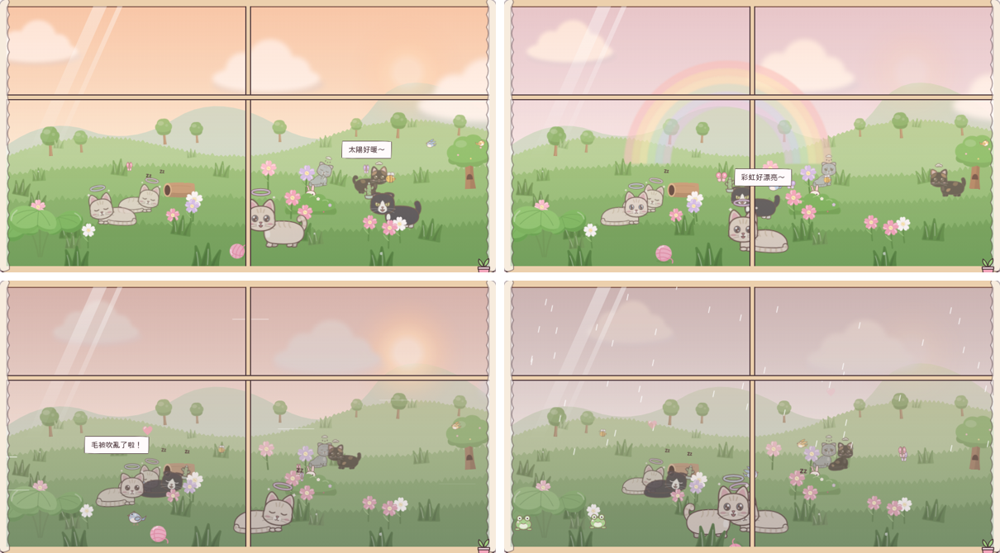
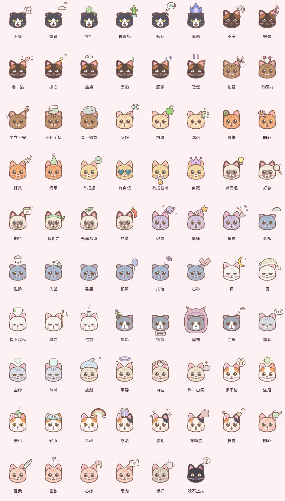
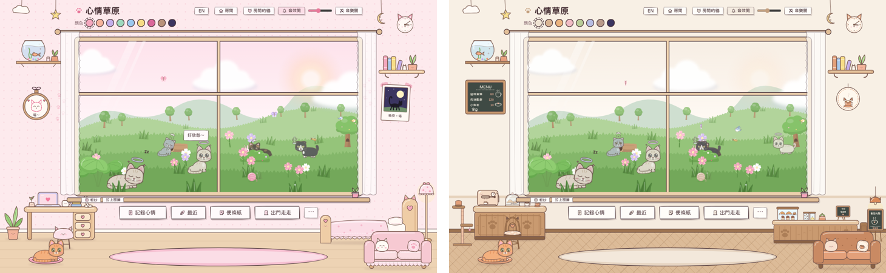
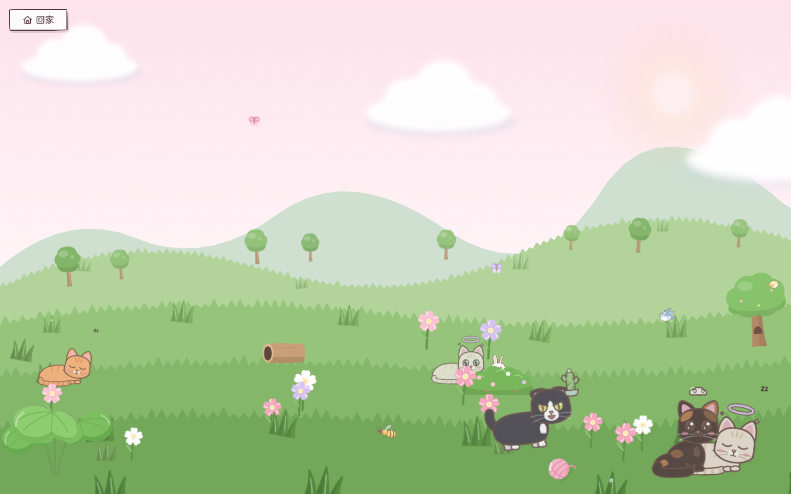
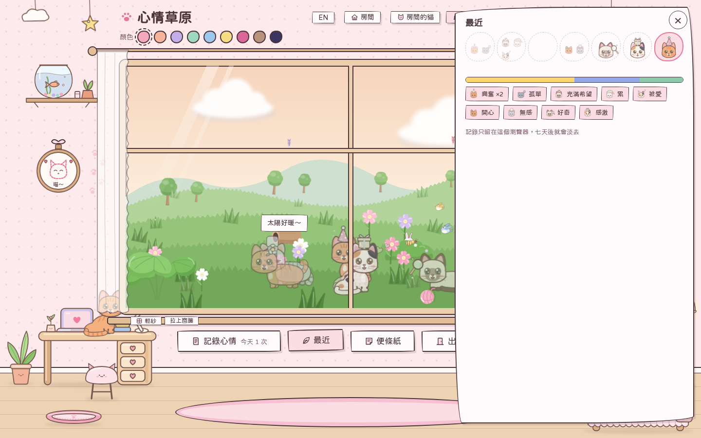
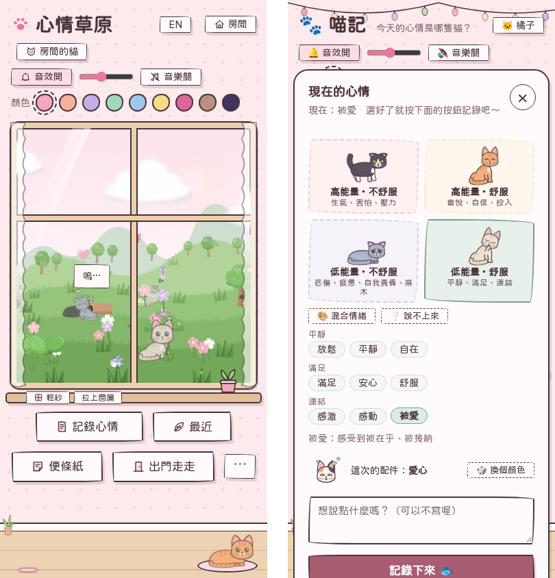

# Mood Meadow 心情草原

[中文](README.md) | **English**

A small web page for practicing noticing and expressing your feelings. Pick the feeling closest to how you feel right now, and a cat runs into the meadow outside the window while the sky changes with your mood. There's also a cat in the room that goes about its own day.

Mood Meadow only keeps the last 7 days: the older an entry gets, the fainter its cat becomes in the meadow, and after 7 days it's gone.

No install, no sign-up — just open the page. Everything stays in your own browser.

**Try it online: <https://ruby510054.github.io/meow/>** (switch to English with the "EN" button in the top right)



> The screenshots show the Chinese interface; everything is also available in English.

> 「當別人問，今天海上天氣好嗎？妳聽到了，妳聽到，都要回答很晴朗。」
>
> 「即使下這麼大的雨也要這樣回答嗎？」
>
> 「是。」
>
> 「即使不想回答也要這樣回答嗎？」
>
> 「是。」
>
> — Wu Ming-Yi, *The Man with the Compound Eyes* (《複眼人》)

> "When someone asks you, 'How's the weather out at sea today?' — whenever you hear it, you must answer: 'Clear and sunny.'"
>
> "Even when it's raining this hard?"
>
> "Yes."
>
> "Even when I don't want to answer?"
>
> "Yes."
>
> (our translation)

Mood Meadow is a small practice tool and can't replace professional help. If you often feel you can't cope, or have thoughts of hurting yourself, please talk to someone you trust or contact a local helpline. In Taiwan: **Taiwan Mental Health Hotline 1925** (24 hours, free), **Lifeline 1995**, **Teacher Chang 1980**.

## Features

### Log your mood
Start with one of four areas (energy × pleasantness), then write your own word. If nothing comes to mind, open a kind of feeling and browse the ready-made words for reference. "Not sure" or just "Okay" are fine to log too.



### Mood weather
The sky outside follows your mood and the time of day: happy is sunny, sad brings rain, and night brings stars and a moon.



### The meadow
Every entry becomes a cat that runs into the meadow outside the window. The cat *is* that feeling: its coat and little accessory follow the feeling, older entries fade, and after 7 days they're gone.



The meadow is also a small system. Birds, a rabbit, frogs, fireflies and a bee come and go with the weather and time, and they and the cats affect each other: little animals come closer to calm cats, and on rainy days some cats look for shelter. These interactions only change what a cat is doing in the moment, never its feeling.

### The room
There's a cat in the room too, living its own day, with an expression that follows your mood. You can change the room, curtains and colors, and stick notes on the wall.



### Go outside, Recent
From the room you can only watch the meadow through the window; "Go outside" takes you out into it, where you can see and tap the cats up close; "Recent" lets you look back over the last 7 days.





### More
Piano music and sound effects, Chinese / English, and it works on desktop and mobile.



## Getting started

### Online
Just open <https://ruby510054.github.io/meow/>. A recent version of Chrome, Edge, Firefox or Safari is recommended.

### Install as an app
Mood Meadow can be installed like an app on your computer or phone, with its own icon and window, and it works offline:

- **Windows / Mac**: open the site in Chrome or Edge and click the "Install" icon at the right of the address bar
- **iPhone / iPad**: open it in Safari, tap "Share" → "Add to Home Screen"
- **Android**: open it in Chrome and choose "Install app" or "Add to Home screen" from the menu

On a phone held sideways, it switches to a landscape layout: the window fills most of the screen, with the buttons underneath.

You need an internet connection the first time. After that it works offline. The font is saved bit by bit while you're online; if offline text uses characters that haven't been saved yet, the system font is shown for them.

### On your own computer
Download or clone this project and open `index.html` in a browser.

### On your own GitHub Pages
1. Fork this repo (or push the project to your own repo)
2. Go to the repo's **Settings → Pages**
3. Under **Source**, choose **Deploy from a branch**, pick the `main` branch and the `/ (root)` folder, then press **Save**
4. After a minute or two, it will be live at `https://<your-account>.github.io/<repo-name>/`

## Data and privacy

- Entries are stored only in **your own browser** (localStorage) and are never uploaded anywhere
- Only the **last 7 days** (including today) are kept; older entries are deleted automatically, and loading a backup only brings in entries from those 7 days
- If you clear your browser data or switch browsers or computers, your entries won't be there. To move them, use "Download backup" at the bottom of the page, then "Load from backup"
- Opening the local `index.html` and opening the GitHub Pages URL don't share entries; use a backup file to move them
- To start over, use "Clear data"

## Customizing feelings

The feelings are defined in [`mood.json`](mood.json):

```text
quadrants (4 areas: energy × pleasantness)
└─ families (feeling families, e.g. "Sadness")
   └─ emotions (feeling words)
        id, label.zh, label.en, desc (description)
        valence (pleasantness, -1 ~ 1), arousal (energy, -1 ~ 1)
special_options: mixed, unsure
```

So the page works as a single file, `index.html` contains an identical copy (inside `<script type="application/json" id="emotionData">`). After editing `mood.json`, replace that whole block with the new content.

- `valence` and `arousal` drive the mood weather and the cats' behavior
- New feeling words without their own accessory use their family's accessory
- Which face and coat a new family uses is set in `FAMILY_FACE` and `FAMILY_COAT` in `index.html`
- English feeling words use `label.en`; English descriptions (`desc`) go in the `EN` table in `index.html`

## Tech

- The whole site is one `index.html`: plain HTML, CSS and JavaScript, with no packages and no build step
- It's a PWA: `manifest.webmanifest` makes it installable, and `sw.js` caches the page, icons and font for offline use. After changing `index.html`, bump the cache version in `sw.js` (`mood-meadow-v2`) so installed copies update
- Cats, furniture and weather are SVGs drawn in code
- Background music and purring are synthesized live with the Web Audio API; meows are trimmed real recordings embedded in the file
- The font is [jf open Huninn](https://fonts.google.com/specimen/Huninn) from Google Fonts; it needs an internet connection, otherwise the system font is used

```text
.
├── index.html     # the whole site
├── mood.json      # feeling definitions
├── manifest.webmanifest  # app name, icons and colors for installing
├── sw.js          # service worker for offline use
├── icons/         # app icons
├── README.md      # Chinese README
├── README.en.md   # English README
├── LICENSE        # MIT license
└── docs/          # screenshots for the README
```

## References

Mood Meadow borrows from the research and ideas below. They informed the design; they don't mean the app itself has been shown to work.

**Research**

- Putting feelings into words is itself a way of regulating them ("naming"):
  - Lieberman, M. D., Eisenberger, N. I., Crockett, M. J., Tom, S. M., Pfeifer, J. H., & Way, B. M. (2007). Putting feelings into words: Affect labeling disrupts amygdala activity in response to affective stimuli. *Psychological Science, 18*(5), 421–428. https://doi.org/10.1111/j.1467-9280.2007.01916.x
  - Torre, J. B., & Lieberman, M. D. (2018). Putting feelings into words: Affect labeling as implicit emotion regulation. *Emotion Review, 10*(2), 116–124. https://doi.org/10.1177/1754073917742706
- Telling subtle feelings apart helps with unpleasant ones (feeling words grouped into families, from mild to strong): Kashdan, T. B., Barrett, L. F., & McKnight, P. E. (2015). Unpacking emotion differentiation: Transforming unpleasant experience by perceiving distinctions in negativity. *Current Directions in Psychological Science, 24*(1), 10–16. https://doi.org/10.1177/0963721414550708
- Writing about emotional experiences (the optional note): Pennebaker, J. W. (1997). Writing about emotional experiences as a therapeutic process. *Psychological Science, 8*(3), 162–166. https://doi.org/10.1111/j.1467-9280.1997.tb00403.x
- Pleasantness × energy (the four areas and the mood weather): Russell, J. A. (1980). A circumplex model of affect. *Journal of Personality and Social Psychology, 39*(6), 1161–1178. https://doi.org/10.1037/h0077714

**Ideas behind the design**

- Emotions are constructed with concepts (your own words first; ready-made words are just references): Barrett, L. F. (2017). The theory of constructed emotion: An active inference account of interoception and categorization. *Social Cognitive and Affective Neuroscience, 12*(1), 1–23. https://doi.org/10.1093/scan/nsw154
- Externalizing: you are not your feeling ("seeing": a named feeling becomes a cat): White, M., & Epston, D. (1990). *Narrative means to therapeutic ends.* W. W. Norton.
- Acceptance: staying with a feeling instead of rushing to change it ("staying"): Hayes, S. C., Strosahl, K. D., & Wilson, K. G. (2012). *Acceptance and commitment therapy: The process and practice of mindful change* (2nd ed.). Guilford Press.
- Systems: influencing each other through relationships (the cats and animals in the meadow): Bateson, G. (1972). *Steps to an ecology of mind.* Chandler.

## Credits

The meow recordings come from Wikimedia Commons, trimmed to mono, with adjusted volume and raised pitch:

| Recording | Author | License |
|---|---|---|
| [2015-11-24.νιαούρισμα.Νιάου.noise reduced.flac](https://commons.wikimedia.org/wiki/File:2015-11-24.%CE%BD%CE%B9%CE%B1%CE%BF%CF%8D%CF%81%CE%B9%CF%83%CE%BC%CE%B1.%CE%9D%CE%B9%CE%AC%CE%BF%CF%85.noise_reduced.flac) | Tsester | CC0 |
| [Meow of a Siamese cat - freemaster2.wav](https://commons.wikimedia.org/wiki/File:Meow_of_a_Siamese_cat_-_freemaster2.wav) | freemaster2 | CC0 |
| [Weibliche Britisch Kurzhaar will Futter C1277 MIAUEN.wav](https://commons.wikimedia.org/wiki/File:Weibliche_Britisch_Kurzhaar_will_Futter_C1277_MIAUEN.wav) | PantheraLeo1359531 | [CC BY 4.0](https://creativecommons.org/licenses/by/4.0/) |

The font [jf open Huninn](https://github.com/justfont/open-huninn-font) (justfont) is licensed under the [SIL Open Font License 1.1](https://openfontlicense.org/).

## Author

[@ruby510054](https://github.com/ruby510054)

## License

The code is released under the [MIT License](LICENSE) — feel free to use, modify and share it, as long as you keep the original license notice.

The meow recordings and the font follow their own licenses listed under Credits above, and are not covered by the MIT License.
